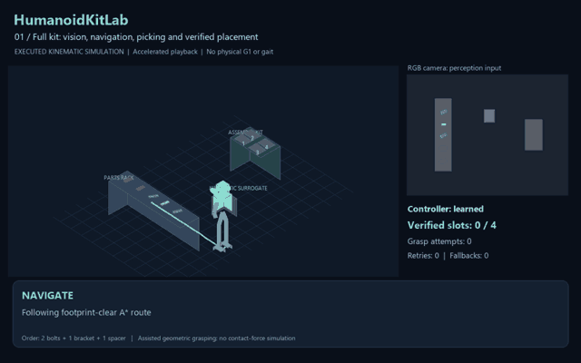
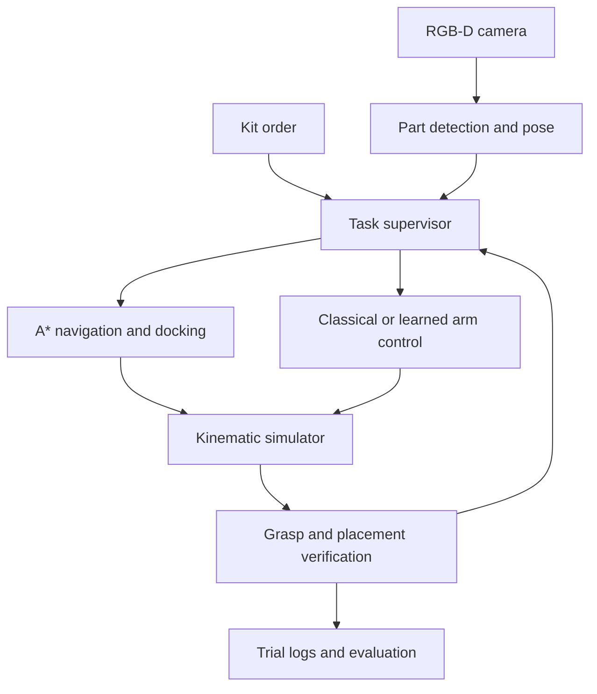
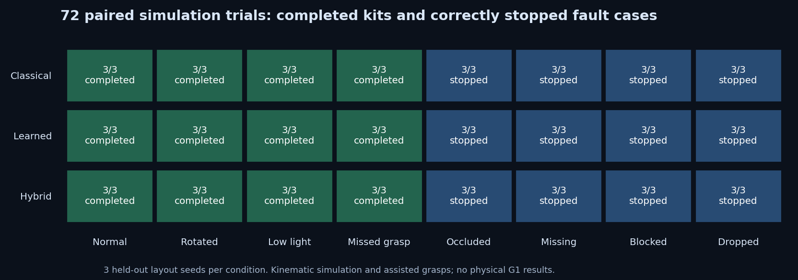
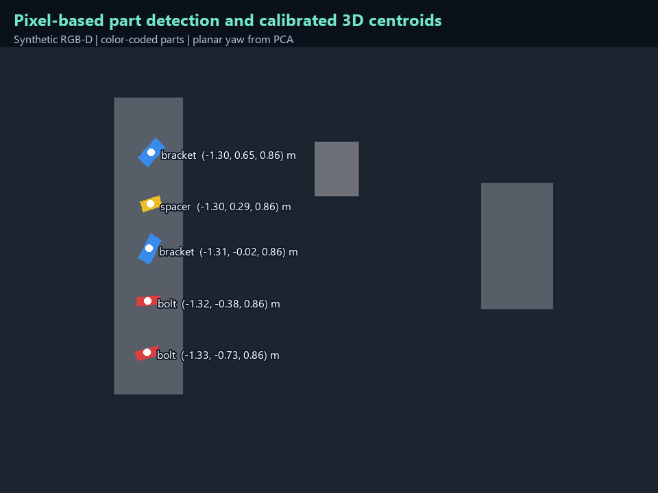
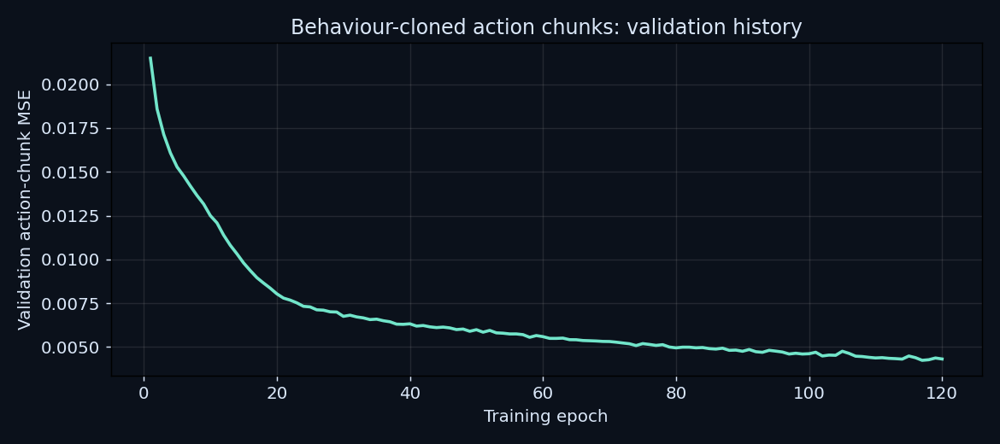

# HumanoidKitLab

### Vision-guided industrial kitting with classical, learned and hybrid robot control

**Python · PyTorch · RGB-D perception · A* path planning · Inverse kinematics · Behaviour cloning · CPU simulation**

A robot receives an assembly order, locates the required parts, navigates between a rack and a tray, picks and rotates each part, and verifies the finished kit. HumanoidKitLab brings these steps into one runnable application, with reproducible experiments and explicit failure handling.

**Current scope:** a custom 3D **kinematic humanoid surrogate**, synthetic RGB-D images, planar base navigation and assisted geometric grasps. Physical Unitree G1 control, biped walking and contact-force simulation remain future work.

## See it work

[](https://raw.githubusercontent.com/Pavan-amikula/HumanoidKitLab/main/docs/media/humanoidkit_demo.mp4)

**[Watch / download the full MP4 demonstration](https://raw.githubusercontent.com/Pavan-amikula/HumanoidKitLab/main/docs/media/humanoidkit_demo.mp4)** · [Video chapters and provenance](docs/media/demo_manifest.json)

The 48-second video shows actual executed simulator states rendered with the application's scene renderer. Playback is accelerated; it is not physical robot footage or a wall-clock performance measurement.

| Demonstration | What to look for |
|---|---|
| **00:00 — Learned controller: complete kit** | A* navigation, arm motion, part rotation, four verified tray slots |
| **00:21 — Hybrid controller: missed grasp** | Failed grasp detected, fresh observation, bounded retry, successful completion |
| **00:43 — Missing stock** | Required inventory is unavailable; the system stops instead of claiming success |

## The task in one minute

**Order:** two bolts, one bracket and one spacer. An extra bracket stays on the rack as a distractor.

1. An overhead RGB-D camera renders the rack. A separate pixel detector estimates each visible part's identity, 3D centroid and tabletop orientation.
2. The task supervisor checks the order against observed inventory.
3. A footprint-aware A* planner moves the base proxy to a docking position.
4. The base stops. An articulated arm uses analytic inverse kinematics to approach, grasp, lift, transfer, rotate and place the part.
5. A fresh camera observation checks part identity, slot position and orientation. The task is complete only after all four slots pass verification.



## What I built

| Component | Implementation | Why it matters |
|---|---|---|
| **Computer vision** | RGB color segmentation, connected components, depth unprojection and PCA orientation | Converts images into actionable part locations; detector does not receive simulator object poses |
| **Navigation** | Four-connected A* with obstacle inflation for the base footprint | Plans around furniture and rejects blocked routes |
| **Manipulation** | Two-link spatial arm IK, wrist rotation, approach/lift/place waypoints and sampled furniture checks | Connects estimated part poses to executable simulated motions |
| **Robot programming** | Explicit task states, command budgets, grasp checks and recovery | Makes failures visible and prevents false completion |
| **Machine learning** | PyTorch MLP predicting six future Cartesian/wrist action commands | Learns control actions from generated expert demonstrations |
| **Feedback control** | Execute the first predicted action, then update from state feedback | Receding-horizon execution with bounded commands |
| **System integration** | Desktop app, optional HTTP dashboard, CLI and JSON logs | Runs the whole pipeline locally and makes evidence inspectable |
| **Evaluation** | Paired layouts, complete-episode data splits, fault injection and 26 tests | Separates measured results from capability claims |

## Classical vs learned vs hybrid

| Method | Arm controller | Recovery behaviour |
|---|---|---|
| **Classical** | Analytic target-error servo | Bounded grasp retry and explicit task failure |
| **Learned** | Behaviour-cloned six-action-chunk MLP | No silent classical fallback; fails on controller timeout |
| **Hybrid** | Same learned policy | Explicit, logged classical fallback on a learned-controller timeout |

All methods share perception, navigation, task sequencing, command limits and verification. Gripper opening/closing remains conventional. The network consumes seven state/target features, **not raw images**. It is inspired by action chunking, **not an ACT or Diffusion Policy implementation**.

## Measured results



**72 paired simulation trials:** 3 controllers × 8 conditions × 3 held-out layout seeds.

| Test group | Observed outcome | Interpretation |
|---|---:|---|
| Normal, rotated parts, low light/noise, missed-grasp recovery | **36 / 36 kits completed** | Every successful order had four verified slots |
| Occluded stock, missing stock, blocked route, dropped part | **36 / 36 orders stopped** | No incomplete or faulted order was labelled complete |
| Automated checks | **26 tests passed** | Geometry, perception, workflows, split integrity, input adapters and recovery |

Three seeds per condition is a small controlled study. These results do not establish real-world industrial reliability or an advantage over the expert the model imitates. See [full results](results/RESULTS.md), [raw evaluation](results/evaluation.json), [test output](results/test_results.txt) and [validation scope](results/VALIDATION.md).

**Learning evidence:** 240 training / 40 validation / 40 held-out action-test episodes; 3,940 / 671 / 681 generated state-action records. Best validation chunk MSE: **0.004238**; held-out action-test chunk MSE: **0.004311**, in normalized action units. These are regression losses, not grasp-success rates. The checkpoint and datasets are included.

<details>
<summary>Inspect perception and training outputs</summary>





[Detected-part JSON](docs/media/perception_detections.json) · [Complete training report](artifacts/training_report.json)

</details>

## Run locally

```powershell
git clone https://github.com/Pavan-amikula/HumanoidKitLab.git
cd HumanoidKitLab
python -m venv .venv
.\.venv\Scripts\python.exe -m pip install -r requirements.txt
.\.venv\Scripts\python.exe app.py desktop
```

The trained policy is included. **Retraining and public-dataset downloads are not needed to run the demo.** Use Python 3.11–3.13 with Tkinter. CPU inference needs no Docker, NVIDIA GPU or web service. On the original laptop, `Start.cmd` uses the existing Python environment.

```powershell
python app.py demo --method learned --scenario rotated --seed 4101
python -m unittest discover -s tests -v
python app.py evaluate --seeds 4101 4102 4103
```

Full commands and troubleshooting: **[Usage guide](docs/USAGE.md)**. To regenerate the MP4, install `requirements-demo.txt`, then run `python -m tools.create_showcase`.

## Research foundation and boundaries

Design references: [ACT / ALOHA](https://tonyzhaozh.github.io/aloha/), [Diffusion Policy](https://diffusion-policy.cs.columbia.edu/), official [Unitree SDK](https://github.com/unitreerobotics/unitree_sdk2_python), [G1 documentation](https://huggingface.co/docs/lerobot/unitree_g1), and [BOP datasets](https://bop.felk.cvut.cz/datasets/). See [source-by-source research notes](docs/RESEARCH.md).

- **Implemented:** kinematic picking/rotation/placement, pixel-based RGB-D perception, route planning, learned action chunks, task execution, verification and experiments.
- **Not implemented:** physical G1 control, biped gait, rigid-body contact/grip dynamics, general industrial part recognition, full 6D pose estimation, ROS 2 or physical deployment.
- **Data used:** generated state-action demonstrations. T-LESS/ITODD were not used for training or evaluation; a tested BOP annotation exporter supports future work.
- **Timing:** modeled cycle time uses assumed motion speeds. Software latency is measured separately. This is a soft real-time interactive app, not a hard real-time controller.

The [G1 integration guide](docs/G1_INTEGRATION.md) describes remaining interfaces and validation. This is an independent portfolio project inspired by industrial kitting, not a completed Volvo/MDU thesis or a claim of collaboration.

## Repository map

| Location | Contents |
|---|---|
| [`humanoidkit/`](humanoidkit/) | Perception, planning, IK, learning, supervisor and interfaces |
| [`artifacts/`](artifacts/) | Trained checkpoint, generated datasets and training report |
| [`docs/media/`](docs/media/) | MP4, animated preview, outputs and video provenance |
| [`results/`](results/) | Evaluation, validation, tests and selected trial evidence |
| [`tests/`](tests/) | Automated geometry, input, perception and recovery checks |
| [`docs/RESUME_HANDOFF.md`](docs/RESUME_HANDOFF.md) | Detailed context, defensible metrics and resume wording |

**Author:** [Amikula Pavan Kumar Goud](https://github.com/Pavan-amikula)
